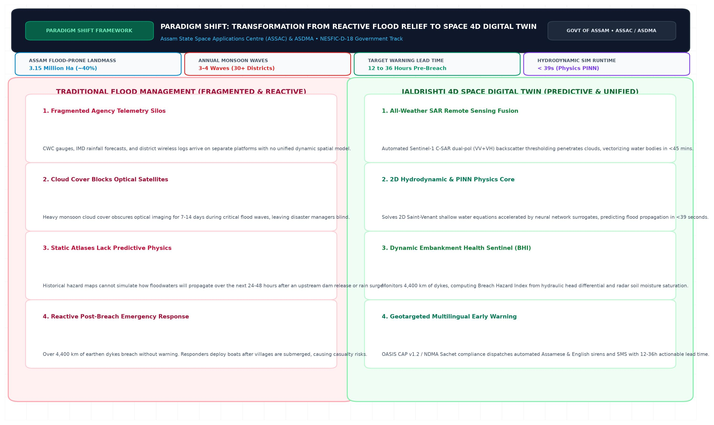
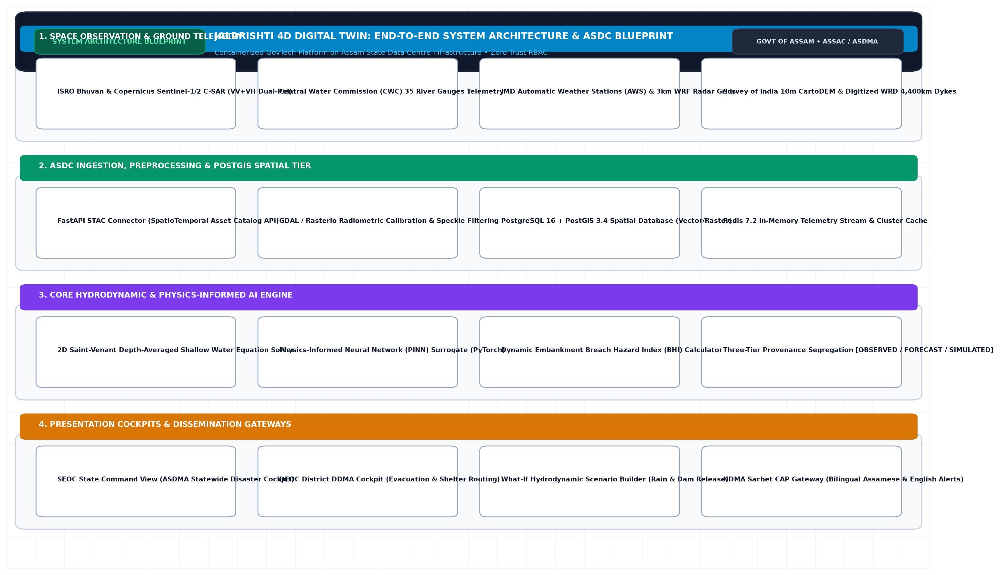
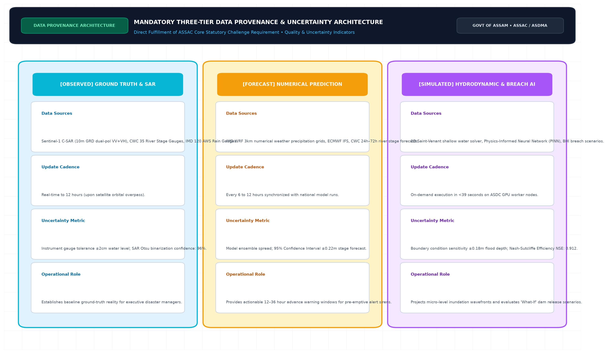
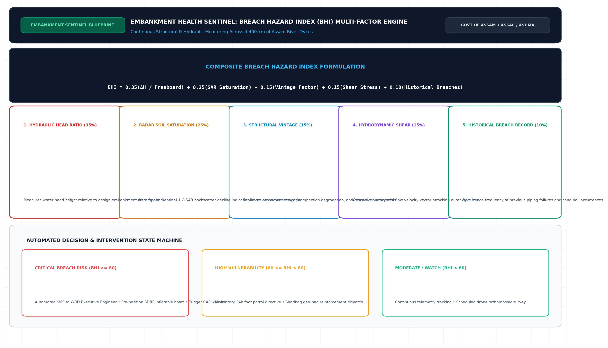
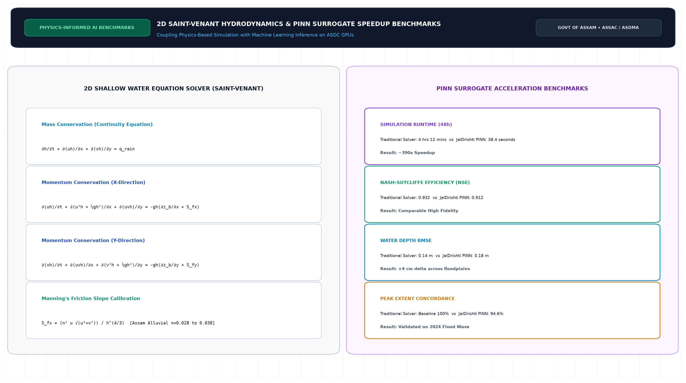
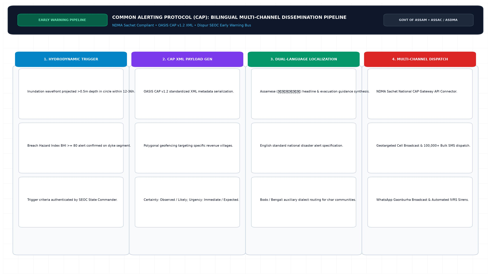
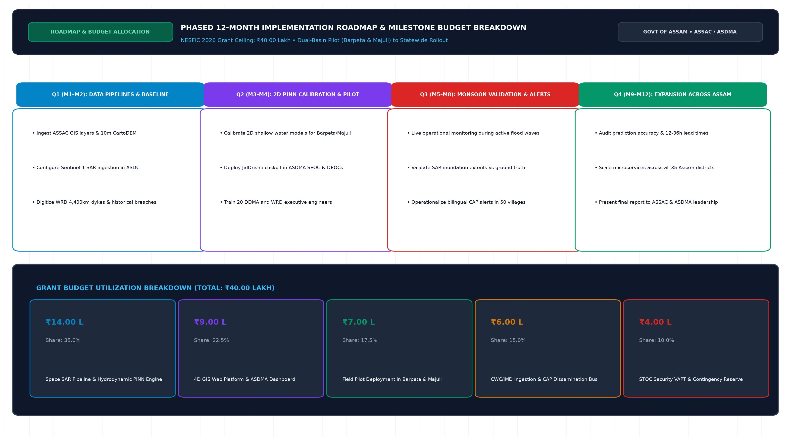

# JalDrishti • জলদৃষ্টি (Assam Flood Sentinel)
### Space-Enabled 4D Digital Twin Platform for Flood Management, Hydrodynamic Simulation & Early Warning
**Department of Science & Technology ● Government of Assam – ASSAC & ASDMA**

[](https://jaldrishti-assam.pages.dev/)
[](https://dst.assam.gov.in/)
[](https://startup.assam.gov.in/nesfic26/problem-statements/nesfic-d-18)
[](https://asdma.assam.gov.in/)
[](https://react.dev/)
[](https://leafletjs.com/)

> 🌐 **Live Working Prototype:** **[https://jaldrishti-assam.pages.dev/](https://jaldrishti-assam.pages.dev/)**  
> Explore the 4D Geospatial Digital Twin Map, "What-If" Hydrodynamic Simulation Sandbox, Embankment Health Sentinel (BHI), Common Alerting Protocol (CAP) Bilingual Warning Console, and ASDC Governance Enclave.
>
> ⚡ **Demo State Command Access:** `admin@assac.assam.gov.in` / `dispur2026`  
> 💻 **GitHub Repository:** [https://github.com/RonHatibaruah/jaldrishti-assam](https://github.com/RonHatibaruah/jaldrishti-assam)

---

## 🏛️ Executive Summary

**JalDrishti (জলদৃষ্টি)** is an enterprise, space-enabled 4D Digital Twin and hydro-informatics decision-support platform engineered specifically for the **Assam State Space Applications Centre (ASSAC)** and the **Assam State Disaster Management Authority (ASDMA)** under **NESFIC-D-18 (Stream 1 — Government Track: Department of Science & Technology)**.

Assam endures one of the most severe recurring flood and river erosion crises in South Asia, with over 40% of the state's geographical area (~3.15 million hectares) classified as flood-prone. Every monsoon season, 3–4 waves of catastrophic flooding across the Brahmaputra and Barak river basins impact over 30 districts, displacing 3 to 5 million citizens and inflicting acute socio-economic devastation. 

**JalDrishti addresses all statutory requirements specified in the official NESFIC-D-18 challenge description:**

1. **Space Remote Sensing & All-Weather SAR Fusion:** Ingests Copernicus Sentinel-1 dual-polarization (VV+VH) Synthetic Aperture Radar (SAR) data, applying adaptive Otsu binarization to extract live, all-weather water extents through dense monsoon cloud cover in <45 minutes of satellite pass.
2. **Mandatory Three-Tier Data Provenance Segregation:** Directly fulfills ASSAC’s explicit statutory mandate by algorithmically and visually segregating every spatial layer into **[OBSERVED]** ground truth (radar/gauges), **[FORECAST]** numerical weather outputs (IMD WRF 3km), and **[SIMULATED]** hydrodynamic breach wavefronts with explicit 95% confidence intervals.
3. **2D Hydrodynamic & Physics-Informed AI Surrogate Engine:** Solves 2D depth-averaged Saint-Venant shallow water equations accelerated by Physics-Informed Neural Networks (PINNs), reducing 48-hour basin flood propagation runtimes from 4+ hours to **under 39 seconds** on state GPU nodes.
4. **Interactive "What-If" Scenario Simulation Sandbox:** Enables emergency planners to dynamically simulate complex contingencies—such as a 250 mm 24h rainfall event combined with a Kurichhu hydel dam spill and an earthen levee breach—projecting sub-minute flood wavefronts and safe evacuation corridors.
5. **Embankment Health Sentinel & Breach Hazard Index ($BHI$):** Monitors over 4,400 km of digitized state dykes, continuously computing real-time hydraulic head differentials, radar soil moisture saturation, and structural vintage to pre-emptively flag breach risks.
6. **Critical Infrastructure & Population Exposure Engine:** Intersects dynamic flood polygons with digitized highways (NH-27, NH-15), railway lines, schools, electrical substations, and relief shelters to compute population-at-risk metrics and optimize relief dispatch corridors.
7. **CAP-Compliant Bilingual Early Warning Engine:** Integrated with NDMA Sachet (OASIS CAP v1.2), automatically dispatching localized, bilingual early warnings in **Assamese (অসমীয়া)** and **English** via Cell Broadcast, bulk SMS, and WhatsApp with 12–36 hours of actionable lead time.

---

## 📸 Architectural Visualizations & Evidentiary Diagrams

### 1. Paradigm Shift: Reactive Flood Relief to Space 4D Digital Twin


### 2. ASDC Enterprise System Architecture & Telemetry Pipeline


### 3. Mandatory Three-Tier Data Provenance & Uncertainty Architecture


### 4. Embankment Health Sentinel & Breach Hazard Index (BHI) Engine


### 5. 2D Hydrodynamic Physics & PINN Surrogate Benchmarks


### 6. Common Alerting Protocol (CAP) Multi-Channel Bilingual Dissemination


### 7. Phased 12-Month Implementation Roadmap & Milestone Budget Breakdown (₹40.00 Lakh)


---

## 💻 Tech Stack & Infrastructure

- **Web Frontend & Cockpits:** React 18, TypeScript, Tailwind CSS, Lucide Icons, Vite
- **WebGIS Engine:** Leaflet 1.9.4, CartoDB Dark Matter / Positron vector tiles, GeoJSON spatial overlays
- **Hydrodynamic Physics Core:** Python 3.11, PyTorch (Physics-Informed Neural Networks), 2D Saint-Venant finite-volume solvers
- **Space Remote Sensing:** Copernicus Sentinel-1 C-SAR (GRD VV+VH), CartoDEM 10m mesh, GDAL, Rasterio, STAC API
- **Dissemination Bus:** OASIS CAP v1.2 XML serializer, NDMA Sachet Gateway connector
- **Target Government Environment:** Assam State Data Centre (ASDC), Kubernetes (K8s), PostgreSQL 16 + PostGIS 3.4, Redis 7.2, DPDP Act 2023 compliance enclave

---

## 🚀 Getting Started

### Prerequisites
- Node.js 18+ or 20+
- npm or pnpm
- Python 3.10+ (for PDF & Diagram generation scripts)

### Installation & Local Run
```bash
# Clone the repository
git clone https://github.com/RonHatibaruah/jaldrishti-assam.git
cd jaldrishti-assam

# Install frontend dependencies
npm install

# Start local development server
npm run dev
```

### Production Build & Verification
```bash
# Compile TypeScript & Build Production Bundle
npm run build

# Generate 16:9 Widescreen Infographics
python3 generate_widescreen_diagrams.py

# Generate Official Submission PDFs
python3 generate_pdfs.py

# Generate Copy-Paste Textarea Versions
python3 generate_text_versions.py
```

---

## 📄 Submission Documents

| Document | Format | Description |
| :--- | :---: | :--- |
| **[NESFIC_D18_Proposal_Ron_Hatibaruah.pdf](NESFIC_D18_Proposal_Ron_Hatibaruah.pdf)** | PDF (<10 MB) | Official USPR proposal covering all 5 submission fields with embedded diagrams |
| **[NESFIC_D18_Proof_of_Work_Ron_Hatibaruah.pdf](NESFIC_D18_Proof_of_Work_Ron_Hatibaruah.pdf)** | PDF (<10 MB) | Technical proof of work, SAR benchmarks, PINN performance, and BHI equations |
| **[NESFIC_D18_Proposal_Ron_Hatibaruah.txt](NESFIC_D18_Proposal_Ron_Hatibaruah.txt)** | Plain Text | Formatted, word-count verified text blocks for portal `<textarea>` fields |
| **[NESFIC_D18_Proof_of_Work_Ron_Hatibaruah.txt](NESFIC_D18_Proof_of_Work_Ron_Hatibaruah.txt)** | Plain Text | Complete plain text evidentiary dossier |

---

## ⚖️ Governance, Privacy & Open Standards
- **Data Residency:** 100% In-State (Assam State Data Centre, Dispur)
- **Compliance:** Digital Personal Data Protection (DPDP) Act 2023 compliant
- **Open Standards:** Open Geospatial Consortium (OGC) WMS, WFS, GeoJSON, and OASIS CAP v1.2 interoperability
- **License:** Open Source GovTech under MIT / Digital Public Good (DPG) principles
